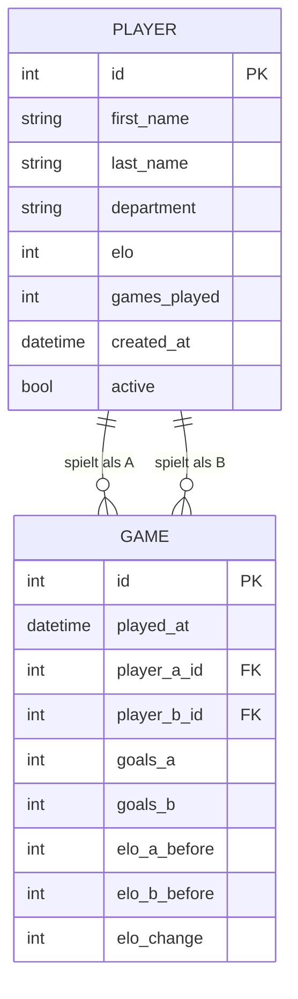

# Kicker-Liga

Web-Applikation für Tischkicker-Spiele (1 vs 1) im Büro mit einer Elo-Rangliste wie im Schach.

Projektarbeit im Modul *Webbasierte Anwendungen*, FHNW, HS2026.

**Gruppe:**   Fabrice Balzan, Ryo Flückiger, Ryan Wolf

---

## Inhalt

1. [Szenario](#szenario)
2. [Installation und Start](#installation-und-start)
3. [MySQL einrichten](#mysql-einrichten)
4. [Tests ausführen](#tests-ausführen)
5. [Ordnerstruktur](#ordnerstruktur)
6. [Architektur](#architektur)
7. [Datenmodell](#datenmodell)
8. [Business-Regeln](#business-regeln)
9. [REST-API](#rest-api)
10. [Testen](#testen)
11. [Designentscheidungen](#designentscheidungen)
12. [Sicherheit](#sicherheit)
13. [Bezug zu den Kursunterlagen](#bezug-zu-den-kursunterlagen)
14. [Mögliche Erweiterungen](#mögliche-erweiterungen)
15. [Quellen und Hilfsmittel](#quellen-und-hilfsmittel)

---

## Szenario

Im Büro steht ein Tischkicker, und jeder behauptet, der Beste zu sein. Die Kicker-Liga erfasst die Spiele und berechnet eine faire Rangliste.

- Jeder Spieler startet mit **1200 Elo-Punkten**.
- Nach einem Spiel gibt man nur ein, **wer gegen wen** gespielt hat und **wie es ausging** (z. B. 10 : 7).
- Die App berechnet die neuen Punkte wie im Schach: Wer einen Stärkeren schlägt, gewinnt viel. Wer als Favorit verliert, verliert viel.

**Funktionen**

| Funktion | CRUD |
|---|---|
| Spiel erfassen (1 vs 1), Elo wird automatisch berechnet | Create |
| Rangliste nach Elo anzeigen | Read |
| Letztes Spiel korrigieren (Resultat ändern), Elo wird neu berechnet | Update |
| Letztes Spiel löschen, Elo wird zurückgesetzt | Delete |
| Spieler anlegen (Name, Abteilung) | Create |

---

## Installation und Start

**Voraussetzung:** Python 3.10 oder neuer

```bash
# 1. In den Projektordner wechseln
cd KickerRank

# 2. Virtuelle Umgebung erstellen und aktivieren
python3 -m venv .venv
source .venv/bin/activate        # Mac / Linux
# .venv\Scripts\activate         # Windows

# 3. Abhängigkeiten installieren
pip install -r requirements.txt

# 4. Starten
python main.py
```

**Mit uv** (schneller, empfohlen im Skript zu Übung 0):

```bash
uv venv
uv pip install -r requirements.txt
uv run python main.py
```

Danach im Browser öffnen: **<http://localhost:8000>**

- Stoppen: `Ctrl + C` im Terminal.
- Die Oberfläche lädt jQuery von einem CDN, braucht also eine Internetverbindung.
- Ab Meilenstein M4 braucht die App eine laufende MySQL-Datenbank, siehe [MySQL einrichten](#mysql-einrichten).

## MySQL einrichten

Wie im Skript (Block 3) vorgesehen, speichert die App ihre Daten in **MySQL**. Benötigt ab Meilenstein M4.

**1. MySQL installieren und starten** (einmalig)

```bash
brew install mysql             # Mac
brew services start mysql
```

Unter Windows: «MySQL Installer» von <https://dev.mysql.com/downloads/installer/>.

**2. Datenbank und Benutzer anlegen** (einmalig)

```bash
mysql -u root -p < docs/setup.sql
```

Alternativ `docs/setup.sql` in MySQL Workbench öffnen und als root ausführen.

`docs/setup.sql` legt die Datenbank `kickerrank` und den Benutzer `kicker` an. Die Tabellen erstellt die App beim ersten Start selbst.

**3. Verbindung**

`config.py` liest die Zugangsdaten aus Umgebungsvariablen bzw. aus einer Datei `.env`. Ohne `.env` gelten die Werte aus `docs/setup.sql` (Benutzer `kicker` auf `localhost`), es ist also nichts weiter zu tun.

Andere Zugangsdaten (z. B. ein anderer Port oder ein anderes Passwort) werden in `.env` eingetragen, nicht im Code:

```bash
cp .env.example .env     # Vorlage kopieren, dann .env anpassen
```

```
DB_HOST=localhost
DB_PORT=3306
DB_USER=kicker
DB_PASSWORD=kicker
DB_NAME=kickerrank
```

`.env` steht in `.gitignore` und gelangt nie ins Repository. Nur die Vorlage `.env.example` ist versioniert.

Die automatischen Tests brauchen **keinen** MySQL-Server, sie verwenden eine SQLite-Datenbank im Arbeitsspeicher.

## Tests ausführen

```bash
uv run pytest          # mit uv
pytest                 # oder mit aktivierter .venv
```

Alle Tests liegen im Ordner `tests/`. Die Oberfläche wird zusätzlich von Hand getestet, die Testfälle stehen in `tests/manuelle_tests.md`. pytest findet automatisch jede Datei, die mit `test_` beginnt, und darin jede Funktion, die mit `test_` beginnt.

---

## Ordnerstruktur

Die Ordner entsprechen den Schichten aus der Architekturübersicht der Vorlesung (Block 3, Abbildung 4).

```
KickerRank/
├── main.py                     # Startpunkt: FastAPI-App, Router, Fehlerbehandlung, Demo-Daten beim Start
├── config.py                   # Zugangsdaten zur Datenbank aus .env bzw. Umgebungsvariablen
├── .env.example                # Vorlage für .env (die echte .env ist nicht im Repository)
├── requirements.txt            # Abhängigkeiten (FastAPI, Uvicorn, SQLAlchemy, PyMySQL, python-dotenv, pytest, httpx)
├── README.md                   # Diese Beschreibung
│
├── docs/                       # Dokumentation, setup.sql für MySQL
│
├── tests/                      # Tests
│   ├── conftest.py             #   Fixtures: SQLite-Testdatenbank, Test-Client
│   ├── test_*.py               #   automatische Tests (pytest)
│   └── manuelle_tests.md       #   manuelle Testfälle für die Oberfläche
│
├── planung/                    # Backlog und Tickets (BACKLOG.md, tickets/)
│
├── presentation/               # PRESENTATION LAYER (läuft im Browser)
│   ├── index.html              #   Views: Rangliste, Spieler anlegen, Spiel erfassen, letztes Spiel
│   ├── css/
│   │   └── style.css           #   Gestaltung
│   └── js/
│       └── main.js             #   View Logic: jQuery, AJAX-Aufrufe, DOM-Manipulation
│
├── service/                    # WEB/REST SERVICE LAYER (FastAPI)
│   ├── messages.py             #   Messages: Pydantic-Modelle für JSON-Anfragen und -Antworten
│   ├── player_endpoints.py     #   REST Endpoints: Rangliste, Abteilungen, Spieler anlegen, bearbeiten, löschen
│   └── game_endpoints.py       #   REST Endpoints: Spiel erfassen, letztes Spiel, korrigieren, löschen
│
├── business/                   # BUSINESS SERVICE LAYER (Geschäftslogik)
│   ├── dtos.py                 #   Data Transfer Objects: PlayerDTO, GameDTO
│   ├── player_service.py       #   Business Service: Rangliste, Spieler anlegen, bearbeiten, deaktivieren
│   ├── game_service.py         #   Business Service: Spiel erfassen, korrigieren, löschen, Gewinner
│   ├── elo.py                  #   Elo-Berechnung
│   ├── departments.py          #   feste Liste der Abteilungen
│   ├── errors.py               #   BusinessError (400) und NotFoundError (404)
│   └── db_entries.py           #   Demo-Daten beim ersten Start, über die Services angelegt
│
└── persistence/                # PERSISTENCE LAYER (SQLAlchemy)
    ├── database.py             #   Engine, Session, Tabellen anlegen
    ├── entities.py             #   Domain Entities: Player, Game
    └── data_access.py          #   Data Access: PlayerRepository, GameRepository
```

---

## Architektur

Die Anwendung ist in vier Schichten aufgeteilt. Jede Schicht ruft nur die Schicht direkt darunter auf.

```
┌──────────────────────────────────────────────┐
│  Presentation Layer       (Browser)          │  HTML + CSS + jQuery
│  Views · View Logic                          │
└───────────────────────┬──────────────────────┘
                        │  HTTP + JSON (AJAX)
┌───────────────────────┴──────────────────────┐
│  Web/REST Service Layer   (FastAPI)          │
│  Messages · REST Endpoints                   │
├──────────────────────────────────────────────┤
│  Business Service Layer   (Geschäftslogik)   │
│  DTOs · Business Services                    │
├──────────────────────────────────────────────┤
│  Persistence Layer        (SQLAlchemy)       │
│  Domain Entities · Data Access               │
└───────────────────────┬──────────────────────┘
                        │  SQL
                 ┌──────┴──────┐
                 │    MySQL    │  kickerrank
                 └─────────────┘
```

### Was liegt in welcher Schicht?

| Schicht | Bestandteile | Aufgabe | Enthält keine … |
|---|---|---|---|
| **Presentation** | `index.html` (Views), `main.js` (View Logic) | Daten anzeigen, Eingaben entgegennehmen, Fehlermeldungen zeigen | Berechnungen, Regeln |
| **Web/REST Service** | `messages.py`, `*_endpoints.py` | JSON annehmen und prüfen (Datentypen), Business Service aufrufen, Antwort als JSON zurückgeben | Geschäftslogik |
| **Business Service** | `dtos.py`, `*_service.py`, `elo.py` | Alle Regeln: Validierung, Elo-Berechnung, Korrektur- und Löschregeln, Transaktionen | SQL-Abfragen, HTTP |
| **Persistence** | `entities.py`, `data_access.py` | Tabellen als Python-Klassen, Daten lesen und speichern | Geschäftsregeln |

### Ablauf einer Anfrage: «Spiel erfassen»

1. **Presentation:** `main.js` liest das Formular und schickt `POST /api/spiele` mit JSON per AJAX.
2. **Service:** `spiel_endpoints.spiel_erfassen()` erhält die Daten als Message `SpielErfassen`. FastAPI hat die Datentypen bereits geprüft.
3. **Business:** `SpielService.spiel_erfassen()` prüft die Regeln, berechnet mit `elo.py` die Punkte und erstellt eine `Spiel`-Entity.
4. **Persistence:** `SpielRepository` speichert Spiel und beide Spieler in **einer Transaktion**.
5. Der Business Service gibt ein `GameDTO` zurück. Der Endpoint wandelt es in die Message `GameResponse` (JSON) um.
6. **Presentation:** `main.js` zeigt «Roy +16 (1216), Lisa −16 (1184)» an und lädt die Rangliste neu.

Die Komponenten werden über **Dependency Injection** (`Depends` von FastAPI) verbunden:
Endpoint → `SpielService` → `SpielRepository` / `SpielerRepository` → `Session`.
Beide Repositories erhalten pro Anfrage dieselbe Session.

---

## Datenmodell

Zwei Tabellen: `player` und `game`. Jedes Spiel verweist zweimal auf die Tabelle `player`, einmal für Spieler A und einmal für Spieler B.



**Tabelle `player`**

| Spalte | Typ | Regeln |
|---|---|---|
| id | Integer | Primärschlüssel, AUTO_INCREMENT |
| first_name, last_name | String(50) | NOT NULL, Kombination eindeutig |
| department | String(50) | NOT NULL, aus fester Liste |
| elo | Integer | NOT NULL, Start 1200 |
| games_played | Integer | NOT NULL, Start 0 |
| created_at | DateTime | automatisch |
| active | Boolean | NOT NULL, Start `true`. `false` = gelöscht (ausgeblendet) |

**Tabelle `game`**

| Spalte | Typ | Regeln |
|---|---|---|
| id | Integer | Primärschlüssel, AUTO_INCREMENT |
| played_at | DateTime | automatisch |
| player_a_id | Integer | Fremdschlüssel → player.id |
| player_b_id | Integer | Fremdschlüssel → player.id, ≠ player_a_id |
| goals_a, goals_b | Integer | 0–10, genau ein Spieler hat 10 |
| elo_a_before, elo_b_before | Integer | Elo der Spieler vor dem Spiel |
| elo_change | Integer | Punkte, die der Gewinner erhält und der Verlierer abgibt |

---

## Business-Regeln

**Spiel erfassen**

1. Spieler A und Spieler B müssen verschieden sein und existieren.
2. Die Tore sind ganze Zahlen; genau ein Spieler hat 10 Tore, der andere 0 bis 9.
3. Der Gewinner ergibt sich aus den Toren.
4. Spiel und beide Spieler werden in einer Transaktion gespeichert.

**Elo-Berechnung** (`business/elo.py`, K = 32)

```
Erwartung von A:     E_A = 1 / (1 + 10^((Elo_B − Elo_A) / 400))
Punkteänderung:      Δ   = round(32 × (1 − E_Gewinner))
```

| Situation | Sieg | Niederlage |
|---|---|---|
| 1200 gegen 1200 | +16 | −16 |
| 1200 gegen 1400 (Aussenseiter) | +24 | −8 |
| 1400 gegen 1200 (Favorit) | +8 | −24 |

**Korrigieren und Löschen**

1. Nur das **neuste** Spiel darf korrigiert oder gelöscht werden, weil alle späteren Spiele auf dessen Elo-Werten aufbauen.
2. **Korrigieren:** Nur das Resultat ist änderbar. Die Elo wird mit den gespeicherten Werten von vor dem Spiel neu berechnet.
3. **Löschen:** Beide Spieler erhalten ihre Elo von vor dem Spiel zurück, die Anzahl Spiele sinkt um 1.

**Spieler anlegen und bearbeiten**

1. Vor- und Nachname dürfen nicht leer sein (Leerzeichen am Anfang und Ende werden entfernt) und höchstens 50 Zeichen lang sein.
2. Die Abteilung muss aus der festen Liste stammen (`business/departments.py`).
3. Die Kombination aus Vor- und Nachname darf es noch nicht geben, auch nicht bei einem gelöschten Spieler. Beim Bearbeiten darf ein Spieler seinen eigenen Namen behalten.
4. Beim Bearbeiten ändern sich nur Name und Abteilung. Elo und Anzahl Spiele entstehen aus den Spielen.

**Spieler löschen**

1. Ein Spieler wird nicht aus der Datenbank entfernt, sondern deaktiviert (`active = false`).
2. Gelöschte Spieler erscheinen nicht mehr in der Rangliste und in den Dropdowns und können keine neuen Spiele bestreiten.
3. Ihre bisherigen Spiele bleiben erhalten.

Verletzte Regeln führen zu einem `BusinessError` (`business/errors.py`), den die App als **HTTP 400** mit `{"error": "…"}` zurückgibt. Gibt es einen Spieler oder ein Spiel nicht, wird ein `NotFoundError` daraus, also **HTTP 404**.

---

## REST-API

| Methode | Endpunkt | Anfrage (JSON) | Antwort |
|---|---|---|---|
| GET | `/api/ranking` | – | aktive Spieler, nach Elo sortiert |
| GET | `/api/departments` | – | Liste der erlaubten Abteilungen |
| POST | `/api/players` | `first_name`, `last_name`, `department` | neuer Spieler (201) |
| PUT | `/api/players/{id}` | `first_name`, `last_name`, `department` | bearbeiteter Spieler |
| DELETE | `/api/players/{id}` | – | leer (204), Spieler wird deaktiviert |
| POST | `/api/games` | `player_a_id`, `player_b_id`, `goals_a`, `goals_b` | erfasstes Spiel (201) |
| GET | `/api/games/last` | – | neustes Spiel oder `null` |
| PUT | `/api/games/{id}` | `goals_a`, `goals_b` | korrigiertes Spiel |
| DELETE | `/api/games/{id}` | – | leer (204) |

Fehler: 400 (Regel verletzt), 404 (gibt es nicht), 422 (falsches Format, von FastAPI). Alle Endpunkte lassen sich unter <http://localhost:8000/docs> ausprobieren.

**Beispiel: Spiel erfassen**

```http
POST /api/games
Content-Type: application/json

{ "player_a_id": 1, "player_b_id": 2, "goals_a": 10, "goals_b": 7 }
```

```json
{
  "id": 13,
  "played_at": "2026-11-21T10:15:00",
  "player_a_id": 1,
  "player_b_id": 2,
  "player_a": { "id": 1, "first_name": "Lukas", "last_name": "Müller", "department": "Development", "elo": 1275, "games_played": 5, "created_at": "…" },
  "player_b": { "id": 2, "first_name": "Sarah", "last_name": "Meier", "department": "Marketing", "elo": 1215, "games_played": 5, "created_at": "…" },
  "goals_a": 10,
  "goals_b": 7,
  "elo_a_before": 1260,
  "elo_b_before": 1230,
  "elo_change": 15,
  "winner_id": 1
}
```

---

## Testen

- **Automatische Tests:** `uv run pytest` (siehe [Tests ausführen](#tests-ausführen)).
- **Swagger UI:** <http://localhost:8000/docs> zeigt alle Endpunkte. Jeder lässt sich dort direkt ausprobieren («Try it out»).
- **Postman:** Anfragen wie im Beispiel oben an `http://localhost:8000/api/...` senden.
- **Browser:** GET-Endpunkte wie <http://localhost:8000/api/rangliste> lassen sich direkt aufrufen.

---

## Designentscheidungen

- **Nur 2 Tabellen, bewusst nicht vollständig normalisiert**
  - **Abteilung als Text** statt eigener Tabelle. Tippfehler verhindert eine feste Liste im Business Layer, die im GUI als Dropdown erscheint.
  - **`elo` und `anzahl_spiele` beim Spieler** sind redundant, weil sie sich aus allen Spielen berechnen liessen. Sie werden gespeichert, damit die Rangliste mit einer einfachen Abfrage geladen werden kann.
  - **`elo_a_vorher`, `elo_b_vorher` und `elo_aenderung` im Spiel** machen das Korrigieren und Löschen ohne Neuberechnung aller Spiele möglich.
- **Spieler deaktivieren statt löschen:** «Delete» setzt `active = false`. Ein echtes Löschen ginge nicht sauber, weil Spiele per Fremdschlüssel auf den Spieler verweisen und das Elo der Gegner aus diesen Spielen entstanden ist. So bleiben alle Spiele und Elo-Werte stimmig, der Spieler verschwindet aber aus Rangliste und Dropdowns.
- **Der Gewinner wird nicht gespeichert.** Er ergibt sich aus den Toren, so können sich keine Daten widersprechen. Berechnet wird er im Business Layer (`winner()` und `loser()` in `business/game_service.py`), nicht in der Entität: Gemäss Kursunterlagen enthalten Datenobjekte keine Geschäftslogik, und «mehr Tore gewinnt» ist eine Spielregel.
- **DTOs statt Entities nach oben:** Der Service Layer kennt keine SQLAlchemy-Objekte. Die Business Services wandeln Entitäten in DTOs (`business/dtos.py`, als `@dataclass`) um und geben nur diese zurück. Die Endpoints wandeln die DTOs in Messages um. Damit gibt es drei Arten von Datenobjekten, je eine pro Schicht (Skript Block 3, Abb. 8):
  - **Entität** (Persistence, `Player`, `Game`): mit der Datenbank verbunden, Änderungen werden beim `commit` gespeichert.
  - **DTO** (Business, `PlayerDTO`, `GameDTO`): reine Kopie der Daten als Ergebnis der Geschäftslogik, inklusive berechneter Werte wie `winner_id`. Eine Änderung an einem DTO hat keine Wirkung auf die Datenbank.
  - **Message** (Service, `PlayerResponse`, `GameResponse` usw.): legt das JSON-Format der API fest und prüft eingehende Daten.
  Die DTOs sind bewusst `@dataclass` statt Pydantic-Modelle, damit der Business Layer nicht von einer Web-Bibliothek abhängt.
- **Validierung nur im Business Layer:** Alle Regeln (Pflichtfelder, Längen, erlaubte Werte, Duplikate, Spielregeln) werden ausschliesslich im Business Layer geprüft und bei Verletzung als `BusinessError` gemeldet, den der Service Layer in HTTP 400 übersetzt. Das Frontend prüft bewusst nichts selbst, sondern zeigt die Meldungen des Servers an. So liegt jede Regel an genau einer Stelle, kann nicht über den Browser umgangen werden und kann nicht an zwei Orten auseinanderlaufen. Pydantic prüft im Service Layer nur das Format (Datentypen, Pflichtfelder). Eine zusätzliche Prüfung im Browser wurde verworfen: Sie hätte nur eine etwas schnellere Rückmeldung gebracht, aber jede Regel doppelt (in Python und JavaScript) erfordert.
- **Demo-Daten über die Services:** Beim ersten Start legt `business/db_entries.py` 6 Spieler und 12 Spiele an, und zwar über `PlayerService` und `GameService`, nicht direkt in die Datenbank. Damit gelten für die Demo-Daten dieselben Regeln wie für echte Eingaben, und das Elo wird vom GameService berechnet statt von Hand eingetragen. Die Datei liegt im Business Layer, weil sie die Services benutzt (die Persistenzschicht darf den Business Layer nicht kennen).
- **Repositories (Data Access):** Alle Abfragen liegen in der Persistenzschicht. Der Business Layer enthält kein SQL.
- **MySQL gemäss Skript:** Die Daten liegen wie in den Kursunterlagen vorgesehen in MySQL (Treiber `pymysql`). Dank SQLAlchemy steckt die Wahl der Datenbank nur in `config.py`.
- **Tests mit SQLite im Arbeitsspeicher:** Die automatischen Tests laufen ohne MySQL-Server, sind schnell und starten jedes Mal mit einer leeren Datenbank.
- **Grenze des Modells:** 2 vs 2 würde weitere Spalten oder eine dritte Tabelle (Spielteilnahme) erfordern.
- **Responsive Design für Handy und Desktop:** Die Oberfläche ist bewusst so gebaut, dass sie auf allen Bildschirmgrössen funktioniert:
  - Abstände und Schriftgrössen in **`rem` statt `px`**. Stellt jemand im Browser oder auf dem Handy eine grössere Schrift ein, wächst das Layout mit (Barrierefreiheit). Rahmenlinien und Rundungen bleiben in `px`, weil sie dünn und gleichmässig bleiben sollen.
  - Der Inhalt hat eine **`max-width`** statt einer festen Breite: auf grossen Bildschirmen begrenzt, auf dem Handy volle Breite.
  - Der Header nutzt **`flex-wrap`**: Auf schmalen Bildschirmen rutscht die Navigation unter den Titel, statt gequetscht zu werden.
  - Eine **Media Query** (`max-width: 500px`) verkleinert Titel und Abstände auf dem Handy.
  - **Prozentwerte für Abstände wurden verworfen**, weil sie sich nach der Breite des Elternelements richten und dadurch auf grossen Bildschirmen zu gross und auf dem Handy zu klein werden.
- **Sprache:** Code (Variablen, Funktionen, Tabellen) und Oberfläche sind auf **Englisch**, die Dokumentation (README, Tickets, Beschreibung) auf **Deutsch**, weil Aufgabenstellung und Bewertung deutschsprachig sind.

---

## Sicherheit

Umgesetzt nach *Datenbanken, Kapitel 11: Datenbankanbindung mit Python Teil 1* (Boeh, 2026) und der Übung «SQL Injection».

| Massnahme | Umsetzung |
|---|---|
| **Keine SQL Injection** | Kein SQL wird aus Benutzereingaben zusammengesetzt (kein f-String, kein `text(...)`). Alle Abfragen laufen über SQLAlchemy (`select(...).where(Player.first_name == first_name)`), das die Werte wie die Platzhalter `%s` eines Prepared Statements getrennt von der Abfrage an die Datenbank schickt. |
| **Zugangsdaten nicht im Code** | `config.py` liest Host, Port, Benutzer, Passwort und Datenbank aus Umgebungsvariablen bzw. `.env` (wie in der Übung, mit `python-dotenv`). `.env` steht in `.gitignore`, versioniert ist nur die Vorlage `.env.example`. Im Code stehen als Standardwerte nur die öffentlichen Werte des Projektbenutzers `kicker` aus `docs/setup.sql`, kein persönliches Passwort. Die URL wird mit `URL.create` gebaut, damit auch Passwörter mit Sonderzeichen wie `#`, `@` oder `?` funktionieren. |
| **Minimale Rechte** | Die App verbindet sich nie als `root`, sondern als `kicker`. Dieser Benutzer gilt nur für `localhost`, nur für die Datenbank `kickerrank` und hat nur die nötigen Rechte: `SELECT, INSERT, UPDATE, DELETE` für die Daten und `CREATE, REFERENCES`, um die Tabellen beim ersten Start anzulegen. Er darf z. B. keine Tabellen löschen (`DROP`) und keine Benutzer verwalten. |
| **Verbindungen schliessen** | `get_session()` schliesst die Session in `finally`, auch bei einem Fehler. Beim Start wird `with SessionLocal() as session` verwendet. |
| **Eingaben prüfen** | Pydantic prüft im Service Layer Format und Datentypen, der Business Layer prüft alle Regeln (siehe Designentscheidungen). |

---

## Bezug zu den Kursunterlagen

Die Persistenzschicht folgt dem Aufbau aus *Datenbanken, Kapitel 12: Datenbankanbindung mit Python Teil 2* (Boeh, 2026). Was zusätzlich zur Architektur aus *Webbasierte Anwendungen* passt, wurde übernommen:

| Konzept aus den Folien | Folie | Umsetzung im Projekt |
|---|---|---|
| Object Relational Mapping: Klasse ↔ Tabelle | 4–7 | `Player` und `Game` in `persistence/entities.py` |
| Beziehung einer Tabelle zu sich selbst (`PersPers`) | 7 | `game` verweist zweimal auf `player` (`player_a_id`, `player_b_id`). Anders als `PersPers` mit eigener `id`, weil dieselben zwei Spieler mehrmals gegeneinander spielen und jedes Spiel eigene Daten hat |
| Objektidentität | 8–9 | Kein eigenes `__eq__`/`__hash__`: Die Session stellt sicher, dass es jeden Datensatz pro Session nur als ein Objekt gibt |
| INSERT vs. UPDATE | 10 | Entscheidet die Session: neue Objekte (`add`) werden eingefügt, geänderte geladene Objekte aktualisiert |
| 3-Schichten-Architektur: Datenobjekt ohne Logik, Data Access ohne Geschäftslogik | 12 | Entitäten ohne Geschäftslogik, Abfragen nur in `persistence/data_access.py`, Regeln nur im Business Layer |
| Repository Pattern | 13 | `PlayerRepository`, `GameRepository` |
| ORM-Klassen mit `Mapped` und `mapped_column` | 16 | `persistence/entities.py` |
| Zugriff über ORM-Modelle mit `select(...)` | 17 | alle Abfragen in den Repositories, kein textuelles SQL |
| SQL Injection | 18 | Kein textuelles SQL, alle Werte über SQLAlchemy gebunden |
| Session und `commit`, Arbeitspakete (Unit of Work) | 19–20 | `save()` in den Repositories; ein `save()` pro Arbeitspaket |
| Lazy Loading bei `relationship()` | 22 | `game.player_a` wird erst bei Zugriff geladen |
| Schema-Erstellung mit `inspect` und `create_all` | 25 | `init_db()` in `persistence/database.py` gibt beim Start die vorhandenen Tabellen aus und legt fehlende an |

Bewusste Abweichungen:

- **Session im Konstruktor statt pro Methode:** Auf Folie 13 erhält jede Repository-Methode die Session als Parameter. Hier erhält das Repository sie einmal im Konstruktor. So passt es zur Verknüpfung der Komponenten mit `Depends` (Webbasierte Anwendungen, Block 3), und der Business Layer muss die Session nicht kennen.
- **Methodennamen:** `find`, `find_by_name`, `all_by_elo`, `add` entsprechen `readById`, `readPersonByName`, `readAll` und `create` aus den Folien (Python-Schreibweise, an die Fachlichkeit angepasst).
- **Kein `rollback` bei `IntegrityError` (Folien 13, 19, 20):** Doppelte Namen fängt bereits der Business Layer mit einer verständlichen Meldung ab. Eine zweite Behandlung in der Persistenzschicht wäre doppelt. Schlägt ein `commit` trotzdem fehl, wird die Transaktion beim Schliessen der Session (`get_session`) automatisch verworfen.
- **Kein Datenbankmigrationstool (Alembic, Folie 26):** Für den Projektumfang ohne Schemaversionen nicht nötig. Siehe Mögliche Erweiterungen.

---

## Mögliche Erweiterungen

- Spielverlauf aller Spiele
- Siegchance vor dem Spiel anzeigen («Lisa gewinnt mit 64 %»)
- Spielerprofil mit Elo-Verlaufsdiagramm
- Abteilungs-Rangliste (Durchschnitts-Elo pro Abteilung)
- Höherer K-Faktor für neue Spieler, Ränge (Bronze, Silber, Gold)
- Schemaversionen und Migrationen mit Alembic

---

## Quellen und Hilfsmittel

_Nach den Vorgaben der FHNW für schriftliche Arbeiten ergänzen._

- Schaaf, M. (2026). *Webbasierte Anwendungen, Block 3 – Einheit 1: Architekturübersicht und erster Teil Präsentationsschicht.* FHNW.
- Boeh, R. (2026). *Datenbanken, Kapitel 11: Datenbankanbindung mit Python Teil 1* und Übung «SQL Injection». FHNW.
- Boeh, R. (2026). *Datenbanken, Kapitel 12: Datenbankanbindung mit Python Teil 2.* FHNW.
- FastAPI-Dokumentation: <https://fastapi.tiangolo.com/>
- SQLAlchemy-Dokumentation: <https://docs.sqlalchemy.org/>
- jQuery-Dokumentation: <https://api.jquery.com/>
- Elo-Wertungssystem: <https://de.wikipedia.org/wiki/Elo-Zahl>
- KI-Hilfsmittel: _Einsatz von Claude (Anthropic) für Ideenfindung, Entwurf und Code-Grundgerüst – Umfang hier genau beschreiben_
